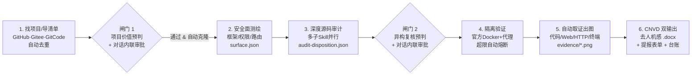

# AuditFlow

> **Modular, Pluggable Multi-Agent Open-Source Security Audit & CNVD Responsible Disclosure Studio (v2.0)**
>
> 一个面向开源软件安全审计与负责任漏洞披露（CNVD / CVD）的**全环节可插拔多 Agent 协作工作台与自动化框架**（内置 **FastAPI + SSE + React + Tailwind** 现代化 5 页 Studio UI + CLI + 15 个可在线编辑/扩展的 Skill）。

[](LICENSE)
[](#一安装准备)
[](#方式一auditflow-studio-可视化工作台推荐日常使用)

---

## 核心解决什么问题？

把传统“手动逛 GitHub → 扫描 → 审源码 → 配 Docker 环境 → 手动截屏 → 手写 Word 报告 → 逐项填 CNVD 网页”的碎片流程，收口成一个**对话驱动、按 Agent 能力强项自动编排、异构互审防幻觉、自动出图出稿**的开源安全审计工作台：



- **对话驱动的主理人工作台（Chat-First Coordinator）**：像使用 AI Agent 一样直接下达自然语言指令（如 *“帮我在 GitHub 找 5 个 AI Agent 项目并导入”*、*“按强项推荐一套团队分配方案”*），支持 `@Agent` 点名协作、SSE 流式工具日志以及**内联 Gate 1 / Gate 2 审批卡片**，彻底告别手动复制粘贴。
- **按强项组织多 Agent & 异构互审**：只读扫描本机已安装的 Agent CLI 与原生配置路径（**Codex / Claude Code / DeepSeek Harness `dsh` / Antigravity CLI / Gemini CLI / OpenCode / OpenAI 兼容 API / Native Subagent**，绝不篡改原生配置）；用能力标签（深度推理、Docker 验证、低成本批量初筛、中文写稿、长上下文、工具调用）一键为 8 个环节分配最优 Agent，并强制提醒**深度审计（`deep_audit`）与漏洞复核（`triage_vuln`）采用异构不同 Agent 交叉复核**。
- **可视化编排画布 & 在线 Skill Studio**：告别丑陋的配置表——在交互式节点画布中点击节点即可热替换 Skill / Agent / 后端；在 **Skill Studio** 中在线预览 Markdown、双栏编辑 `SKILL.md` 与 `skill.yaml`、导入 `.md`、新建或 Fork Skill，所有修改安全保存在 `skills_custom/` 覆盖层（内置 Skill 永不被覆盖，随时一键恢复默认）。
- **全场景 4 类自动出图 + 可选真 Burp 导流**：自动生成代码红框图、Playwright 真实本地 Web 对照图、类 Burp Repeater 左右分栏 HTTP 报文图（开启 `burp_upstream_proxy` 后可将验证流量自动导流进本机 Burp History）以及 DB/RPC/CLI/单测终端图。

---

## 一、安装准备

需要 **Python 3.11+**（支持 Windows、Linux、WSL2）：

```bash
# 1. 进入项目目录并可编辑安装
cd auditflow
pip install -e ".[dev]"

# 2. 安装 Playwright Chromium（用于渲染高清代码图、HTTP/终端图及截取本地 Web 页面）
#    注：即使未装 Chromium，代码图/HTTP图/终端图也会自动降级为 Pillow 清晰离线渲染
python -m playwright install chromium
```

> 提示：若本机已有 Chrome 或 Edge，可直接设置环境变量 `AUDITFLOW_CHROMIUM_CHANNEL=chrome` 或 `msedge`，无需重复下载 Chromium。

---

## 二、完整配置指南（你需要配置哪些内容？）

第一次使用前，先从示例复制两份本地配置文件（两份文件均已被 `.gitignore` 忽略，不会误提交到 Git）：

```bash
# Linux / macOS
cp config/env.example.yaml config/env.yaml
cp config/pipeline.example.yaml config/pipeline.yaml

# Windows PowerShell
copy config\env.example.yaml config\env.yaml
copy config\pipeline.example.yaml config\pipeline.yaml
```

### 2.1 环境变量（存放敏感 Token / API Key）

| 环境变量名 | 是否必需 | 用途 | 示例值 |
|---|---|---|---|
| `AUDITFLOW_OPENAI_API_KEY` | 用 `openai-api` 适配器时必填 | 调 DeepSeek / Qwen / OpenAI 兼容接口 | `sk-xxxx` |
| `AUDITFLOW_OPENAI_BASE_URL` | 用第三方兼容端点时必填 | 指定 OpenAI 兼容 API 基地址 | `https://api.deepseek.com/v1` |
| `GITHUB_TOKEN` | 建议配置 | 提高 GitHub 搜项目速率上限 | `ghp_xxxx` |
| `GITEE_TOKEN` | 搜 Gitee 时选填 | Gitee 开放 API 令牌 | `xxxx` |
| `GITCODE_TOKEN` | 搜 GitCode 时必填 | GitCode 仓库搜索令牌 | `xxxx` |

PowerShell 临时设置示例：
```powershell
$env:AUDITFLOW_OPENAI_BASE_URL="https://api.deepseek.com/v1"
$env:AUDITFLOW_OPENAI_API_KEY="sk-your-key"
$env:GITHUB_TOKEN="ghp_your-token"
```

### 2.2 `config/env.yaml`（路径、远程机器、代理与隔离护栏）

打开 `config/env.yaml`，只需按需修改以下 4 块：

```yaml
paths:
  windows_report_output_dir: "C:/Users/你的用户名/Desktop/漏挖"   # 最终 .docx 与 CNVD 表单输出目录
  tracker_db_path: "./.auditflow_cache/tracker.sqlite"          # 本地 SQLite 状态机与去重台账
  excel_sync:
    enabled: false                                              # 设为 true 可自动备份并追加汇总 Excel
    excel_path: "C:/Users/你的用户名/Desktop/漏挖/漏洞汇总.xlsx"

backends:
  ssh-ubuntu:
    host: "Ubuntu2404"                                          # 对应 ~/.ssh/config 中的 Host 别名
    workspace_root: "/home/wood/audit-pipeline/workspaces"      # Ubuntu 上的工作区绝对路径
  wsl2:
    distro: "Ubuntu-24.04"                                      # 若改用本机 WSL2 跑 Docker 则填发行版名
    workspace_root: "/home/wood/audit-pipeline/workspaces"

docker_verify:
  http_proxy: "http://127.0.0.1:7890"                           # Docker 拉镜像/构建用的代理端口（直连留空 ""）
  https_proxy: "http://127.0.0.1:7890"
  no_proxy: "localhost,127.0.0.1,::1"
  port_range: [18000, 19999]
  enforce_port_range: false                                     # false 允许 80/8035/8080/8088 等默认隔离端口
  startup_timeout_sec: 300
  max_retries: 2                                                # 部署排错最多重试 2 次，超限自动清理并熔断
  allowed_target_hosts: ["localhost"]
  allowed_target_cidrs:                                         # 默认放行本机回环、Docker 网桥与 VM 私网段
    - "127.0.0.0/8"
    - "::1/128"
    - "10.0.0.0/8"
    - "172.16.0.0/12"
    - "192.168.0.0/16"
  burp_upstream_proxy: null                                     # 填 "http://192.168.159.1:8080" 可自动导流真 BP
```

### 2.3 `config/pipeline.yaml`（各阶段热替换 Skill / Agent / 后端）

每一阶段都可以独立指定 `skill`、`adapter` 和 `backend`：

```yaml
stages:
  scout:          { skill: "scout/ai-agent",            adapter: "openai-api",      backend: "ssh-ubuntu" }
  triage_project: { skill: "triage/project-worthiness", adapter: "openai-api",      backend: "local" }
  surface_map:    { skill: "audit/surface-mapper",      adapter: "dsh",             backend: "ssh-ubuntu" }
  deep_audit:
    skills: ["audit/auth-rbac", "audit/file-exec", "audit/query-parser"]
    adapter: "dsh"           # 可随时换为 claude-code / codex / native-subagent
    backend: "ssh-ubuntu"    # 可随时换为 wsl2 / local
  triage_vuln:    { skill: "triage/vuln-worthiness",    adapter: "native-subagent", backend: "local" }
  verify:         { skill: "verify/docker-official",    adapter: "codex",           backend: "ssh-ubuntu" }
  evidence:       { renderers: ["code", "web", "http", "term"],                     backend: "ssh-ubuntu" }
  report:         { skill: "report/cnvd-docx-writer",   adapter: "native-subagent", backend: "local" }
```

### 2.4 一键体检

配置完后运行 `doctor`，立即确认哪些适配器与执行后端已就绪：

```bash
auditflow doctor
```

---

## 三、如何完整地从“找项目”跑通到“产出 CNVD 报告”？

AuditFlow 提供 **三种操作入口**（底层共享同一份 SQLite 台账与 JSON 契约，可随时混用）：

### 方式一：AuditFlow Studio 可视化工作台（推荐日常使用）

仓库已内置预构建好的 React + Tailwind 生产包（`src/auditflow/ui/dist/`），安装 Python 依赖后**单命令直接启动**，无需额外配置 Node.js：

```bash
auditflow ui
# 默认由 FastAPI + Uvicorn 启动并打开 http://127.0.0.1:8787（支持 --port 8787 --no-open）
```

工作台包含 **5 个核心页面**：
1. **对话工作台（Chat-First Coordinator）**：三栏式 Agent 对话工作台（会话列表 + SSE 流式对话与工具调用轨迹 + 右侧团队名册/证据图与 CNVD 栏位一键复制），直接在对话中粘贴仓库链接或发指令，即可弹出**内联 Gate 1 / Gate 2 审批卡片**直接点选放行；
2. **可视化编排画布（Workflow Studio）**：以交互式节点与连线呈现 8 阶段流水线与两道人工闸门，自带**异构互审检测**（检查 `deep_audit` 与 `triage_vuln` 是否为不同 Agent），支持**「按 Agent 强项一键最优分配」**并在右侧节点检查器中热替换 Skill、Agent 与后端；
3. **Skill Studio**：按阶段分类浏览全部 Skill，支持 **Markdown 渲染预览 / 双栏实时编辑 `SKILL.md` 与 `skill.yaml` / 新建 Skill / 导入本地 `.md` / Fork 派生**；所有自定义修改保存在 `skills_custom/` 覆盖层，绝不改写内置文件，随时一键恢复默认；
4. **Agent 能力中心（Agent Hub & API Providers）**：只读探测本机已安装的 Agent CLI 与原生配置目录，可视化管理能力标签、成本档位与首选后端，支持注册自定义 CLI Agent、查看 `doctor` 体检，并提供 **DeepSeek / OpenAI / 阿里云百炼 Qwen / OpenRouter / Ollama** 一键预设与连通性测试；
5. **环境设置（Settings）**：表单化编辑 `config/env.yaml`（报告输出目录、Excel 同步、SSH Ubuntu、WSL2、Docker 代理与私网 CIDR、可选 Burp 导流），并可随时切回原始 YAML 源码模式。

> 如需二次开发前端界面：
> ```bash
> cd frontend
> npm install
> npm run dev      # 开发模式（Vite 代理 /api 到 127.0.0.1:8787）
> npm run build    # 构建生产包至 ../src/auditflow/ui/dist/
> ```

### 方式二：在 Antigravity / Claude Code 中“纯 Agent 对话驱动”

在主 Agent 会话中直接让它加载总控 Skill：

> “请加载 `skills/dispatcher/master-dispatcher/SKILL.md`，按 `config/pipeline.yaml` 帮我从 GitHub 找 5 个 AI Agent 开源项目并走完审计与 CNVD 报告流程，到 Gate 1 和 Gate 2 时停下来让我勾选。”

主 Agent 会自动调用 `auditflow` CLI、委派各阶段适配器并在两道闸门暂停等你拍板。

### 方式三：完整 8 步端到端实战命令行流水线

下面是一条从**获取项目**到**产出最终 `.docx` 与 CNVD 提报表单**的完整命令清单（将 `<TARGET>` 替换为第 1 步输出的 `target_id`，`<CAND>` 替换为如 `CAND-01`）：

#### Step 1：获取项目并自动去重入库
```bash
# 方式 A：从 GitHub / Gitee / GitCode 按关键词抓取（支持 --history 导入历史汇总 Excel 跳过已挖项目）
auditflow scout --platform github --query "ai agent mcp" --limit 10 --history ./历史漏洞汇总.xlsx

# 方式 B：直接导入你整理的仓库清单（支持 .txt / .md / .csv / .xlsx）
auditflow scout --from-list ./targets.txt --history ./历史漏洞汇总.xlsx
```
> 产出：`workspaces/<TARGET>/meta.json`（状态：`DISCOVERED`）。

#### Step 2：项目价值预评判 + Gate 1 审批 + 自动浅克隆
```bash
# 1) 调 triage_project 给项目打分（CNVD 适配度、可部署性、红海饱和度风险）
auditflow stage triage_project <TARGET>

# 2) Gate 1 人工确认，加 --auto-clone 会自动执行 git clone --depth 1 到 workspaces/<TARGET>/repo/
auditflow decide <TARGET> --approve --actor yourname --auto-clone
# （不想挖某个项目时用：auditflow decide <TARGET> --reject --actor yourname）
```
> 产出：源码克隆至 `workspaces/<TARGET>/repo/`（状态：`CLONED`）。

#### Step 3：安全面测绘（替代盲扫）
```bash
auditflow stage surface_map <TARGET>
```
> 产出：`workspaces/<TARGET>/surface.json`（框架、是否 root 运行、鉴权拦截器、白名单、高危入口；状态：`MAPPED`）。

#### Step 4：多视角深度源码审计
```bash
auditflow stage deep_audit <TARGET>
```
> 产出：`workspaces/<TARGET>/audit-disposition.json` 与各候选 `candidates/<CAND>/audit.json`（状态：`AUDITED`）。

#### Step 5：漏洞价值预评判 + Gate 2 人工勾选
```bash
# 1) 结合默认部署可达性、权限边界与历史 CVE 去重给出筛选建议表
auditflow stage triage_vuln <TARGET>

# 2) 仅对值得投入环境验证的高价值候选放行（其余用 --reject 标为 REJECTED_FP）
auditflow decide <TARGET> --candidate <CAND> --approve --actor yourname
```
> 状态推进为：`VERIFY_APPROVED`。

#### Step 6：本地隔离部署（带代理与熔断）+ 动态验证
```bash
# 1) 若目标自带 docker-compose.yml，可用内置部署助手（自动注入 env.yaml 代理端口、超 max_retries 自动 down 清理）
auditflow deploy-docker <TARGET> <CAND> --backend ssh-ubuntu --exposed-url http://127.0.0.1:8035 --healthcheck-url http://127.0.0.1:8035/

# 2) 执行验证阶段（默认由 codex 适配器执行正负向对照并产出 verify.json）
auditflow stage verify <TARGET> <CAND>

# 若环境排错超限自动熔断进入 NEEDS_HUMAN_ENV，人工修好环境后执行恢复再重跑：
auditflow resume-environment <TARGET> <CAND> --actor yourname
```
> 产出：`candidates/<CAND>/deploy-log.json` 与 `verify.json`（状态：`VERIFIED`）。验证完毕可用 `auditflow teardown-docker <TARGET> --backend ssh-ubuntu` 彻底清理容器。

#### Step 7：自动截取 4 类证据图 + 跨机回传 Windows
```bash
# 1) 根据 audit.json 与 verify.json 自动生成源码红框图、本地 Web 页面图、HTTP 报文对照图、终端输出图
auditflow stage evidence <TARGET> <CAND>

# 也可按需手动单独补截任意一张图（支持真实隔离 HTTP(S) URL + Cookie/Header 注入）：
# auditflow web-snapshot "http://127.0.0.1:8035/admin/template/index" out.png --show-address-bar
# auditflow code-shot repo/file.go 44 66 code.png --highlight 46
# auditflow http-shot verify.json 2 http.png
# auditflow term-shot verify.json 3 term.png

# 2) 若前几步在 Ubuntu2404 / WSL2 上运行，把全部 JSON 契约与 evidence/*.png 安全拉回 Windows 本地
auditflow sync-pull <TARGET> <CAND> --backend ssh-ubuntu
```
> 状态推进为：`EVIDENCE_READY`。

#### Step 8：一键生成去人机感 CNVD Word 报告 + 网页提报表单 + 台账同步
```bash
# （可选）若希望先由写作 Skill 润色 cnvd-form.json：
# auditflow stage report <TARGET> <CAND>

# 生成最终 .docx、_cnvd_form.md、_cnvd_form.json（若 env.yaml 开启 excel_sync 则自动备份并追加汇总表）
auditflow report --target <TARGET> --candidate <CAND>
```
最终在 `config/env.yaml` 指定的 `windows_report_output_dir` 中得到：
- `<target_id>__<candidate_id>.docx`（图文混排完整 CNVD Word 报告）
- `<target_id>__<candidate_id>_cnvd_form.md`（按 CNVD 官网栏位排好的复制粘贴表单）
- `<target_id>__<candidate_id>_cnvd_form.json`（结构化存档）

---

## 四、扩展：如何接入新 Agent 或添加新 Skill？

### 1. 零代码接入任何新 Agent CLI
直接在 `config/pipeline.yaml` 的 `adapters:` 下添加一条 `type: "custom-cli"`，然后在任意阶段引用它的名字即可：
```yaml
adapters:
  my-new-agent:
    type: "custom-cli"
    command_template: "my-agent run --skill {skill_path} --workspace {workspace_dir} --out {output_file}"
```

### 2. 添加新 Skill
在 `skills/<stage>/<your-skill-name>/` 下放入 `skill.yaml` 与 `SKILL.md`（规范见 [docs/ADAPTERS_AND_SKILLS.md](docs/ADAPTERS_AND_SKILLS.md)），无需修改一行 Python 代码即可在 `pipeline.yaml` 中切换生效。

---

## 五、1 分钟离线体验 Demo 与测试

无需配置任何 API Key 或远端机器，直接用内置样例跑一遍“自动出图 → 生成 Word 报告 + CNVD 表单”：

```bash
python -c "from pathlib import Path; from shutil import copytree; p=Path('.auditflow_cache'); p.mkdir(exist_ok=True); copytree('tests/fixtures', p/'demo', dirs_exist_ok=True)"
auditflow report --workspace .auditflow_cache/demo --out output
```

运行全部自动化测试：
```bash
python -m pytest -v
```

---

## 工程文档索引

- [v2.0 Studio 架构与 UI 设计规格](docs/V2_STUDIO_DESIGN.md)
- [架构设计与状态机](docs/ARCHITECTURE.md)
- [7 个核心 JSON 数据契约](docs/SCHEMAS.md)
- [可插拔 Agent 适配器与 Skill 规范](docs/ADAPTERS_AND_SKILLS.md)
- [四类确定性截图渲染与 CNVD 双输出规范](docs/EVIDENCE_AND_REPORTING.md)
- [分期实施计划与验收标准](docs/IMPLEMENTATION_PLAN.md)
- [安全与负责任使用声明](SECURITY.md)

## License

[MIT](LICENSE)
