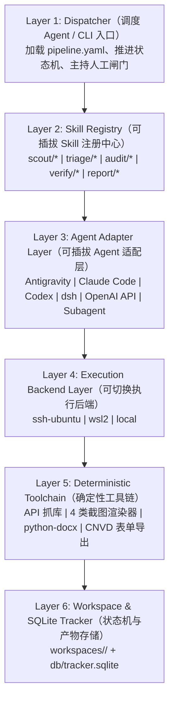
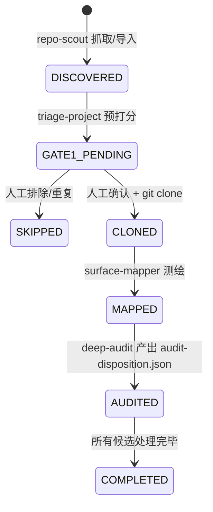
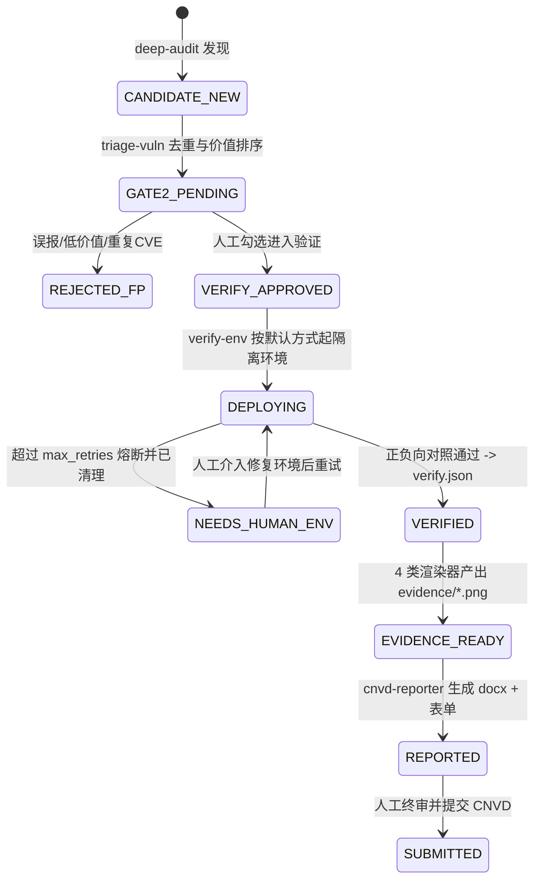

# AuditFlow 系统架构设计

本文档定义 AuditFlow 的分层架构、Dispatcher 调度机制、状态机流转、跨机执行模型以及隔离验证熔断策略。

当前版本以人工交接、审核后产物导入和离线报告为入口。可用命令与环境要求见 [README](../README.md)。

---

## 1. 设计目标与核心约束

1. **三层解耦（全环节可替换）**
   - **Skill 可替换**：同一阶段可注册多个 Skill（按目标类型/漏洞模式切换），只要遵守统一的输入/输出 JSON Schema。
   - **Agent 可替换**：调度层不硬编码任何特定 AI 厂商或工具，通过统一 `AgentAdapter` 接入 Antigravity、Claude Code、Codex、DeepSeek Harness (`dsh`)、OpenAI 兼容 API、原生 Subagent 或任意自定义 CLI。
   - **执行后端可替换**：支持 `ssh-ubuntu`（推荐：独立 Ubuntu 虚拟机，原生 Linux 语义 + 快照回滚）、`wsl2`（本机 WSL2 ext4 + Docker）与 `local`（纯本地脚本/文档渲染）。
2. **契约驱动（Artifact-Driven Pipeline）**
   - 阶段间不传递冗长自然语言聊天记录，只传递经过 Pydantic / JSON Schema 严格校验的结构化产物文件（见 `docs/SCHEMAS.md`）。
3. **事实与文风解耦**
   - 审计 Agent 与验证 Agent（如 `dsh` / `codex`）**只负责产出结构化技术事实与原始证据**，不直接生成最终中文 Word 报告正文；
   - 最终面向 CNVD 的自然中文技术叙述与排版由绑定到 `report` 阶段的写作 Agent（默认 Windows 侧 Antigravity / Claude）结合模板规则生成，彻底消除“人机复核腔”。
4. **安全隔离与严格熔断**
   - 所有动态验证仅限本地一次性隔离容器/VM；
   - 环境搭建实行有限次排错（`max_retries`）+ 强制清理熔断，杜绝无限循环修环境烧 Token。

---

## 2. 六层系统架构

---

## 3. 调度 Agent（Dispatcher）工作原理

Dispatcher 既可以作为**纯 Agent 驱动的 Master Skill**（由你在 Antigravity / Claude Code 对话中加载 `skills/dispatcher/SKILL.md`），也可以通过底层确定性 Python 引擎 `auditflow` CLI 协助管理状态和校验。

### 调度执行单阶段的 6 步标准协议

1. **解析配置**：读取 `config/pipeline.yaml`，获取当前阶段对应的 `skill`、`adapter`、`backend`、`timeout`、`retry_policy`。
2. **前置校验**：检查上一阶段必需的输入契约文件是否存在且通过 Schema 校验。
3. **组装任务包（Dispatch Envelope）**：将 `SKILL.md` 提示词、目标路径、输入 JSON 路径、输出 JSON 目标路径以及环境约束（如代理端口、禁止修改业务源码）封装成标准 `AdapterRequest`。
4. **委派执行**：通过选定的 `ExecutionBackend`（本地 / SSH / WSL2）调用选定的 `AgentAdapter` 执行任务，并把原始轨迹/日志落盘到 `logs/<stage>_<timestamp>.log`。
5. **契约验收**：对输出 JSON 执行 Pydantic Schema 校验；若缺失必填字段或格式非法，触发有上限的自动修正（最多 1 次 schema repair），否则报错挂起。
6. **状态推进与闸门控制**：更新 `tracker.sqlite` 状态；若到达 Gate 1 或 Gate 2，渲染精简决策表并暂停等待用户勾选。

---

## 4. 状态机设计

### 4.1 项目级状态机（`targets` 表）

### 4.2 候选漏洞级状态机（`candidates` 表）

---

## 5. 典型跨机部署拓扑（Windows + Ubuntu2404）

针对当前使用场景，推荐采用**控制/成稿与计算/沙箱分离**的默认拓扑：

- **Windows 本机（Control & Reporting Plane）**
  - 运行主 Agent（如 Antigravity）和 `auditflow` 调度 CLI；
  - 负责读取你的项目清单、展示闸门 1/2 交互清单、接收用户审批；
  - 通过 `scp/sftp` 从执行端拉回轻量产物（`meta.json`、`audit.json`、`verify.json`、`evidence/*.png`）；
  - 在 Windows 本地运行报告命令，按本机配置输出 `.docx` 与 `_cnvd_form.md`。
- **Ubuntu2404 VM（Execution & Sandbox Plane）**
  - 保存克隆源码（`~/audit-pipeline/workspaces/`），零跨系统 I/O 损耗；
  - 本地运行 `dsh`（DeepSeek Harness）、`codex`、`claude`、Semgrep 等审计/验证工具；
  - 本地运行 Docker（配置统一代理端口）或隔离脚本部署目标应用，随时支持虚拟机快照回滚；
  - 本地运行 `Playwright` + `Pygments` 渲染高清代码图、Web 页面图、HTTP 对比图与终端图。
- **WSL2 单机可选模式**
  - 若目标仅为标准 `docker-compose.yml` 轻量 Web 项目，可将 `pipeline.yaml` 中的执行后端一键切为 `wsl2`，直接在 Windows 本机 WSL2 ext4 目录内运行，无需启动额外 VM。

---

## 6. 隔离验证防死循环（Fail-Fast）架构

为彻底解决传统全自动验证工具在 Docker 环境中反复改错陷入死循环的问题，`verify` 阶段强制执行以下不变量：

1. **官方默认部署优先**：优先执行仓库自带 `docker-compose.yml`、官方预构建镜像或官方文档默认安装步骤；仅允许注入代理环境变量、映射空闲端口和添加漏洞成立所需的明确前置配置（如反向代理），**禁止修改目标业务源码**。
2. **统一代理与端口池管理**：从 `config/env.yaml` 自动读取 Docker pull/build 代理端口（如 `http://127.0.0.1:7890`）与宿主机可用端口区间（如 `18000-19999`），避免端口冲突与镜像拉取卡死。
3. **部署过程全记录**：每步部署命令、镜像版本、环境变量、排错尝试必须追加写入 `deploy-log.json`，同时供最终报告的“部署方式”章节直接引用。
4. **硬熔断与强制清理**：
   - 单次启动超时上限：`startup_timeout_sec`（默认 `300s`）；
   - 最大环境排错尝试次数：`max_retries`（默认 `2`）；
   - 触达上限后，框架强制执行 `teardown`（停止并清理测试容器/临时文件），将候选状态设为 `NEEDS_HUMAN_ENV`，向上汇报结构化阻塞原因（错误类型、最后 50 行日志、已尝试修复项），绝不继续空转。
